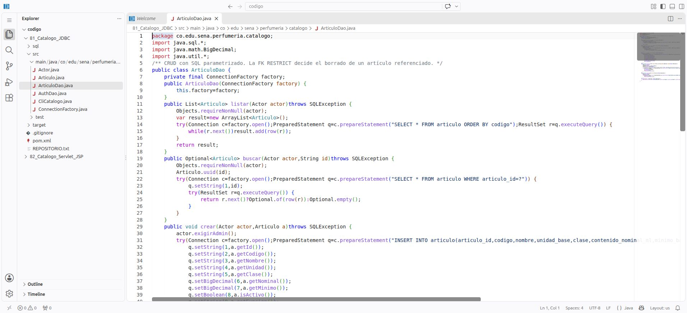

# Catálogo de artículos con Java y JDBC

**Actividad GA7-220501096-AA2-EV01 · Esencias & Estilo Solano**  
Jhon Steven Alvarez Ruiz · Ficha 3388966 · 17 de noviembre de 2026

Aplicación de consola para crear, consultar, actualizar y eliminar artículos con JDBC explícito y MySQL. Trabaja sobre el modelo de perfumería del proyecto y comprueba la identidad del operador antes de acceder al catálogo. Administrador puede modificarlo; Vendedora puede consultarlo.

## Compilación y uso

Después de configurar la conexión, ejecute:

```bash
mvn package dependency:copy-dependencies -DincludeScope=runtime
```

Defina `AUTH_USER` y `AUTH_PASSWORD` en el entorno del proceso con una cuenta activa de la instalación. Estas variables no conceden un perfil: el perfil se lee de la base de datos al autenticar.

```bash
java -cp "target/classes:target/dependency/*" co.edu.sena.perfumeria.catalogo.CliCatalogo listar
java -cp "target/classes:target/dependency/*" co.edu.sena.perfumeria.catalogo.CliCatalogo crear DEMO-FRASCO30 "Frasco DEMO 30 ml" UNIDAD ENVASE FRASCO 30 5
java -cp "target/classes:target/dependency/*" co.edu.sena.perfumeria.catalogo.CliCatalogo editar UUID_DEL_ARTICULO "Frasco DEMO 30 ml" 8
java -cp "target/classes:target/dependency/*" co.edu.sena.perfumeria.catalogo.CliCatalogo eliminar UUID_DEL_ARTICULO
```

`crear` devuelve el UUID asignado; úselo en las operaciones siguientes. Para un artículo sin capacidad nominal use `-` en esa posición. En Windows, el separador del classpath es `;`. Códigos de salida: `0` operación completada, `2` datos inválidos o artículo inexistente, `3` acceso denegado, `4` operación JDBC rechazada. Un código duplicado o una referencia existente producen un rechazo claro y conservan los datos anteriores.

## Alcance del catálogo

El artículo identifica un insumo, envase, accesorio o perfume. No es una oferta de venta: el precio se registra mediante versiones de `precio_oferta`, y el costo y el saldo proceden de los movimientos de inventario. Este módulo no modifica esas cantidades ni registra ventas.

La creación fija código, nombre, unidad base, clase, función material, capacidad nominal cuando corresponde y mínimo. La actualización modifica **nombre y mínimo**; conserva código, unidad, clase, función y capacidad. La eliminación física solo procede si el artículo no tiene referencias. Las claves foráneas con `ON DELETE RESTRICT` conservan las fórmulas, suministros, conteos y movimientos existentes.

`ML`, `UNIDAD` y `G` son unidades base. El litro es una unidad de ingreso: el esquema conserva el factor exacto `1 L = 1000 ML`. No existe conversión entre gramos y mililitros sin una medida o densidad aplicable. Los costos desconocidos permanecen `NULL`; no se sustituyen por cero.

## Estructura y persistencia

- `Articulo`: metadatos y validaciones de texto, cantidades, unidades y funciones.
- `ArticuloDao`: `INSERT`, `SELECT`, `UPDATE` y `DELETE` con `Connection`, `PreparedStatement` y `ResultSet` de JDBC.
- `ConnectionFactory`: abre una conexión por operación desde variables del entorno. `try-with-resources` cierra conexión, sentencia y resultado.
- `AuthDao` y `Actor`: autentican mediante los hashes BCrypt existentes y comprueban el perfil del usuario y el estado de su integrante del equipo.
- `sql/01_Estructura_perfumeria.sql`: estructura MySQL 8.4 del proyecto, con 28 tablas y 46 claves foráneas. No incluye cuentas, claves ni movimientos de personas reales.

Las sentencias SQL usan parámetros. No se concatena el texto ingresado por una persona en el SQL. Los códigos son únicos; un duplicado no reemplaza al artículo anterior. Los textos admiten hasta 160 caracteres sin controles y las cantidades tienen hasta seis decimales, dentro de `DECIMAL(18,6)`.

## Configuración local

Requisitos: JDK 21, Maven 3.10 y MySQL 8.4. Cree un esquema de laboratorio vacío y cargue `sql/01_Estructura_perfumeria.sql` con su operador MySQL. Use cuentas activas de la instalación del proyecto; este adaptador no crea cuentas ni restablece claves. Si el esquema es nuevo, inicialice antes la aplicación principal según su [README de instalación](https://github.com/SirHegel/sena-pos-integral/tree/main/Perfumeria_Esencias_Estilo_Solano), con `PS_BOOTSTRAP_PASSWORD` definida por el operador: la aplicación principal crea el Administrador inicial; desde ella se pueden dar de alta las demás cuentas. Después, ambos adaptadores acceden a ese mismo esquema de laboratorio. Para acceder a datos reales se requiere una configuración de seguridad y operación propia del entorno de destino.

Defina `DB_URL`, `DB_USER` y `DB_PASSWORD` en el proceso que ejecuta el módulo. `DB_URL` tiene la forma `jdbc:mysql://127.0.0.1:3306/esquema_asignado?connectionTimeZone=UTC&forceConnectionTimeZoneToSession=true`. La cuenta de ejecución requiere lectura de `usuario` e `integrante_equipo` y CRUD de `articulo`; la importación del esquema corresponde al operador. No escriba claves en el código, en el repositorio ni en capturas.

## Verificación del módulo

`mvn test` ejecuta 11 pruebas JUnit propias de las reglas compartidas: límite de texto, caracteres especiales, escala y signo decimal, identidad canónica, frasco/capacidad, perfume abierto, edición limitada y perfil Vendedora. Las dos aplicaciones incluyen la misma suite; no representan 22 reglas diferentes. Son independientes de las 44 unitarias y las 428 comprobaciones de integración de la aplicación principal.

El ensayo conjunto de estos dos adaptadores completó 59 controles JDBC/HTTP sobre datos sintéticos en una base separada. Comprobó CRUD, SQL parametrizado, códigos duplicados, borrado protegido, conservación de metadatos, sesión, roles y CSRF; también verificó el ingreso de un litro como 1000 ml y el costo desconocido como `NULL`. Es una ejecución técnica de laboratorio, sin atribuir operación ni aceptación al negocio.

## Versionamiento

Repositorio del proyecto: https://github.com/SirHegel/sena-pos-integral

El paquete contiene las fuentes y un archivo Git bundle para consultar el historial local con `git clone versionamiento/catalogo.bundle catalogo`. Los directorios `target` se generan al compilar y no forman parte de las fuentes.

## Capturas de la aplicación



